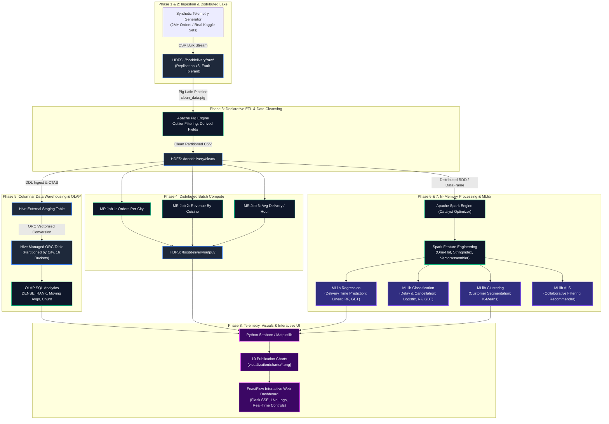

# 🚀 End-to-End Big Data Analytics Pipeline for Food Delivery Systems

[](https://hadoop.apache.org/)
[](https://spark.apache.org/)
[](https://hive.apache.org/)
[](https://pig.apache.org/)
[](https://spark.apache.org/mllib/)
[](https://www.python.org/)
[](https://www.docker.com/)
[](LICENSE)

An enterprise-grade, distributed big data engineering and predictive analytics pipeline designed to process, store, transform, query, and model hyper-local on-demand food delivery telemetry at multi-million scale. Built using **Hadoop (HDFS, MapReduce), Apache Pig, Apache Hive, Apache Spark, and Spark MLlib**, complemented by a real-time **Flask & Vanilla JS interactive dashboard**.

---

## 📑 Table of Contents

- [Executive Summary & Motivation](#-executive-summary--motivation)
- [Key Business & Research Questions](#-key-business--research-questions)
- [System Architecture & Dataflow](#-system-architecture--dataflow)
- [Repository Structure](#-repository-structure)
- [Dataset Specifications & Schema](#-dataset-specifications--schema)
- [Multi-Phase Processing Pipeline](#-multi-phase-processing-pipeline)
  - [Phase 1: Ingestion & Data Generation](#phase-1-high-volume-data-generation--ingestion)
  - [Phase 2: HDFS Distributed Storage](#phase-2-hdfs-distributed-data-lake-architecture)
  - [Phase 3: Apache Pig ETL & Cleansing](#phase-3-apache-pig-latin-batch-etl--cleaning)
  - [Phase 4: Hadoop MapReduce Processing](#phase-4-distributed-hadoop-mapreduce-batch-analytics)
  - [Phase 5: Hive Data Warehousing & OLAP](#phase-5-apache-hive-data-warehousing--olap-sql)
  - [Phase 6: Apache Spark Fast Analytics](#phase-6-in-memory-processing--spark-feature-engineering)
  - [Phase 7: Distributed Machine Learning with MLlib](#phase-7-distributed-predictive-modeling-spark-mllib)
  - [Phase 8: Publication Visualizations & FeastFlow Dashboard](#phase-8-publication-visualizations--feastflow-web-dashboard)
- [Empirical Benchmarks & Performance Comparison](#-empirical-benchmarks--performance-comparison)
- [Quick Start & Deployment Modes](#-quick-start--deployment-modes)
  - [Mode A: Docker Multi-Container Cluster](#mode-a-docker-multi-container-cluster-recommended)
  - [Mode B: Standalone Local Runner & Web Dashboard](#mode-b-standalone-zero-dependency-local-runner)
  - [Mode C: Native Hadoop / Spark Cluster](#mode-c-native-hadoop--spark-cluster)
- [Interactive Web UI (FeastFlow Analytics)](#-interactive-web-ui-feastflow-analytics)
- [Academic Reports & Presentation Documentation](#-academic-reports--presentation-documentation)
- [Tool Justification & Engineering Trade-Offs](#-tool-justification--engineering-trade-offs)
- [License & Academic Credits](#-license--academic-credits)

---

## 🌟 Executive Summary & Motivation

On-demand food delivery platforms (such as Zomato and Swiggy) process millions of multi-stakeholder transactions daily across diners, merchant restaurants, and gig-economy delivery fleets. Every transaction yields complex, heterogeneous telemetry: high-frequency spatial GPS pings, order preparation delays, road traffic bottlenecks, monsoon weather disruptions, dynamic coupon redemptions, and multi-channel payment records.

Traditional monolithic relational database management systems (RDBMS) encounter severe I/O, memory, and scalability bottlenecks under these conditions, particularly during peak lunch (**12:00–14:00**) and dinner (**19:00–22:00**) bursts. 

This project implements an **End-to-End Big Data Analytics Pipeline** addressing this challenge through a resilient, decoupled data lakehouse architecture:
- **Fault-tolerant distributed storage** with automated namespace partitioning on HDFS.
- **Declarative ETL cleaning and schema enrichment** via Apache Pig Latin.
- **Deterministic batch aggregation** utilizing multi-key Hadoop MapReduce algorithms.
- **Columnar data warehousing and OLAP windowing** with Apache Hive (ORC, partition pruning, Bloom filters, and customer bucketing).
- **Fast in-memory feature engineering and graph-like transformations** with Apache Spark.
- **Distributed predictive modeling** with Spark MLlib for delivery ETA regression, delay/cancellation classification, and K-Means diner segmentation.
- **Live web dashboard and publication-grade visual reporting** for operational stakeholders.

---

## 🎯 Key Business & Research Questions

1. **Revenue & Geographic Velocity**: Which cuisines, restaurant franchises, and metropolitan zones drive top-tier Gross Merchandise Value (GMV)?
2. **Temporal & Fleet Dynamics**: What are the peak ordering windows, and how do delivery durations correlate with fleet availability and hour-of-day?
3. **Environmental Choke Points**: To what degree do monsoon rainstorms, high traffic levels, and spatial travel distance compound delivery delays?
4. **Predictive Delivery ETA (Regression)**: Can we predict dispatch-to-doorstep duration within an RMSE of $\pm 4$ minutes across diverse weather and traffic conditions?
5. **Operational Risk (Classification)**: Can we predict order cancellations and critical delivery delays ($>45$ minutes) to trigger proactive fleet intervention?
6. **Customer Behavioral Clustering (Unsupervised)**: Can we partition customer bases by order frequency, spending tiers, discount elasticity, and cancellation propensity?
7. **Personalized Discovery (Recommendation)**: Can we generate personalized restaurant recommendations using collaborative filtering (Alternating Least Squares - ALS)?

---

## 🏗️ System Architecture & Dataflow



---

## 📁 Repository Structure

```
food-analytics/
├── data/
│   ├── generate_data.py          # Parametric synthetic data generator (Faker, 2M+ rows)
│   ├── food_delivery_data.csv    # Active transactional dataset
│   ├── sample/                   # 1,000-row lightweight sample dataset
│   ├── test_datasets/            # Curated Kaggle benchmark datasets
│   └── output/                   # Staged pipeline output summaries and metrics
├── hdfs/
│   ├── setup_hdfs.sh             # HDFS directory structure setup (/fooddelivery/*)
│   └── ingest.sh                 # Fault-tolerant raw CSV ingestion script
├── pig/
│   ├── clean_data.pig            # Data cleansing, schema validation & outlier rejection
│   └── derive_fields.pig         # Feature derivation (speed, revenue margins, weather flags)
├── mapreduce/
│   ├── orders_per_city/          # Hadoop MapReduce: Order density and volume per city/area
│   ├── revenue_per_cuisine/      # Hadoop MapReduce: Revenue & GMV aggregation by cuisine
│   └── avg_delivery_per_hour/    # Hadoop MapReduce: Hourly delivery time averages
├── hive/
│   ├── create_tables.hql         # External, partitioned (city), and bucketed (ORC) DDL
│   ├── analytics_queries.hql     # Advanced OLAP queries, ranking, and window functions
│   └── performance_compare.hql   # Benchmark suite: CSV text vs. partitioned ORC tables
├── spark/
│   ├── spark_analytics.py        # PySpark core analytics replicating MR/Hive pipelines
│   ├── feature_engineering.py    # Spark ML vectorization, scaling, and one-hot encoding
│   └── performance_compare.py    # Benchmark runner: MapReduce vs. Hive vs. PySpark
├── mllib/
│   ├── regression_model.py       # Delivery ETA prediction (Linear, Decision Tree, RF, GBT)
│   ├── classification_model.py   # Delay & cancellation classifiers (Logistic, RF, GBT)
│   ├── clustering_model.py       # Customer segmentation with K-Means (Silhouette optimal)
│   └── recommendation_model.py   # Collaborative filtering via ALS matrix factorization
├── visualization/
│   ├── generate_charts.py        # Matplotlib/Seaborn generator for 10 publication charts
│   └── charts/                   # Exported high-resolution visualization figures (PNG)
├── web/
│   ├── index.html                # FeastFlow Web UI (Modern, Glassmorphism, Dark Mode)
│   ├── style.css                 # Custom Vanilla CSS design system
│   ├── app.js                    # Interactive UI logic, live charts & SSE log stream
│   ├── server.py                 # Flask server: API endpoints, SSE logs, dataset switcher
│   └── charts/                   # Synced presentation charts for web rendering
├── scripts/
│   ├── run_pipeline.sh           # Unix/Linux/macOS master bash pipeline orchestrator
│   ├── run_pipeline.ps1          # Windows PowerShell automated orchestrator
│   ├── run_pipeline.bat          # Windows Command Prompt batch launcher
│   ├── local_pipeline.py         # Complete standalone 8-phase Python fallback pipeline
│   ├── launch_ui.ps1             # PowerShell script to launch Flask dashboard
│   ├── launch_ui.bat             # Batch launcher for Flask dashboard
│   └── environment_setup.sh      # Cluster and prerequisite verification script
├── docs/
│   ├── ACADEMIC_PROJECT_REPORT_PHASE_1_TO_6.md # Full 25-page academic project report
│   ├── report_template.md        # Comprehensive report template with metrics
│   ├── presentation_slides.md    # Defense slide deck outline with speaker notes
│   ├── viva_questions_and_answers.md # 50+ oral defense & viva questions with solutions
│   └── architecture_diagram.md   # Architectural breakdown & deep-dive documentation
├── docker-compose.yml            # Multi-container Hadoop 3.2.1 & Spark 3.0 cluster config
├── Makefile                      # Cross-platform command automation
├── requirements.txt              # Python library dependencies
└── README.md                     # Project documentation
```

---

## 📊 Dataset Specifications & Schema

The pipeline processes synthetic telemetry representing realistic Indian metropolitan food delivery ecosystems modeled after Swiggy and Zomato.

### Scale & Distribution Characteristics
- **Volume**: 2,000,000 records (~500 MB uncompressed CSV; scalable from 1,000 sample rows to 10M+).
- **Temporal Horizon**: 12 months (January 2025 – December 2025).
- **Entities**: 500 partner restaurants, 50,000 unique customers, 2,000 delivery riders.
- **Geographic Coverage**: 10 Tier-1 and Tier-2 Indian hubs (*Bangalore, Mumbai, Delhi-NCR, Hyderabad, Pune, Chennai, Kolkata, Ahmedabad, Jaipur, Chandigarh*).

### Attribute Data Dictionary

| # | Attribute | Data Type | Zone | Description |
|---|---|---|---|---|
| 1 | `order_id` | `INT / BIGINT` | Raw/Clean | Unique monotonic order identifier |
| 2 | `customer_id` | `STRING` | Raw/Clean | Customer entity identifier (`C00001`–`C50000`) |
| 3 | `restaurant_id` | `STRING` | Raw/Clean | Merchant entity identifier (`R0001`–`R0500`) |
| 4 | `cuisine` | `STRING` | Raw/Clean | 20 distinct cuisines (*North Indian, Biryani, Chinese, Italian, etc.*) |
| 5 | `city` | `STRING` | Raw/Clean | Metropolitan city (Partition key in Hive & Spark) |
| 6 | `area` | `STRING` | Raw/Clean | Specific micro-locality (*Indiranagar, Koramangala, Bandra, etc.*) |
| 7 | `order_time` | `TIMESTAMP` | Raw/Clean | Timestamp when order was placed |
| 8 | `delivery_time` | `TIMESTAMP` | Raw/Clean | Timestamp when order was delivered |
| 9 | `delivery_duration_min` | `FLOAT` | Raw/Clean | End-to-end delivery duration in minutes (Target variable) |
| 10 | `distance_km` | `FLOAT` | Raw/Clean | Great-circle travel distance between merchant and customer |
| 11 | `order_value` | `INT / FLOAT` | Raw/Clean | Gross monetary transaction amount (₹) |
| 12 | `discount` | `INT / FLOAT` | Raw/Clean | Promotional discount applied (₹) |
| 13 | `payment_method` | `STRING` | Raw/Clean | Transaction medium (*UPI, Credit Card, Debit Card, COD, Wallet*) |
| 14 | `delivery_partner_id` | `STRING` | Raw/Clean | Designated rider identifier (`DP0001`–`DP2000`) |
| 15 | `partner_rating` | `FLOAT` | Raw/Clean | Historical rider rating ($3.5$ to $5.0$) |
| 16 | `weather` | `STRING` | Raw/Clean | Environmental condition (*Clear, Cloudy, Rainy, Stormy, Foggy*) |
| 17 | `traffic_level` | `STRING` | Raw/Clean | Road congestion level (*Low, Medium, High, Jam*) |
| 18 | `status` | `STRING` | Raw/Clean | Order outcome (*Delivered, Cancelled*) |
| 19 | `customer_rating` | `FLOAT` | Raw/Clean | Post-delivery customer rating score ($1.0$ to $5.0$) |
| 20 | `net_revenue` | `FLOAT` | Derived | Computed net merchant income (`order_value - discount`) |
| 21 | `speed_kmh` | `FLOAT` | Derived | Calculated transit velocity (`(distance_km / duration_min) * 60`) |
| 22 | `is_peak_hour` | `INT` | Derived | Binary flag for lunch (12-14) or dinner (19-22) rush |
| 23 | `is_delayed` | `INT` | Derived | Binary indicator for delivery duration $>45$ minutes |

### Realistic Planted Telemetry Patterns
- **Monsoon & Traffic Penalty**: Rainy weather combined with `High`/`Jam` traffic causes a **~35% surge** in transit duration.
- **Cash-on-Delivery (COD) Churn**: Orders placed via COD display an **~8.2% cancellation rate** (nearly $3\times$ higher than digital UPI/Card transactions at ~2.8%).
- **Bimodal Order Volume**: Order volumes spike sharply during lunch (12:00–14:00) and dinner (19:00–22:00) peaks.
- **Distance Elasticity**: Transit duration exhibits strong linear correlation with distance ($r \approx 0.78$), perturbed by traffic and weather multipliers.

---

## ⚙️ Multi-Phase Processing Pipeline

### Phase 1: High-Volume Data Generation & Ingestion
Generates realistic multi-dimensional order telemetry using Python's `Faker` and writes immutable raw CSV archives.

```bash
# Generate 2,000,000 rows (approx. 500 MB)
python data/generate_data.py --rows 2000000 --output data/food_delivery_data.csv

# Or generate a quick 1,000-row testing sample
python data/generate_data.py --sample --output data/food_delivery_data.csv
```

### Phase 2: HDFS Distributed Data Lake Architecture
Sets up namespaced directories across the distributed storage cluster with replication policies.

```bash
cd hdfs/
chmod +x setup_hdfs.sh ingest.sh
./setup_hdfs.sh
./ingest.sh ../data/food_delivery_data.csv
```
**HDFS Namespace Layout:**
- `/fooddelivery/raw/` &rarr; Immutable landing zone for uncleaned ingested data.
- `/fooddelivery/clean/` &rarr; Verified, schema-conforming partitions produced by Pig.
- `/fooddelivery/output/` &rarr; Aggregated multi-key results generated by MapReduce.
- `/fooddelivery/models/` &rarr; Persisted Spark MLlib model binaries and evaluation metrics.

### Phase 3: Apache Pig Latin Batch ETL & Cleaning
Executes [clean_data.pig](file:///Users/ankush2004/Developer/Big-Data%20Project/food-analytics/pig/clean_data.pig) to enforce schema integrity, filter out-of-bound errors (distance $>50$ km, negative values), and compute derived metrics (`net_revenue`, `speed_kmh`).

```bash
pig -x mapreduce pig/clean_data.pig
```

### Phase 4: Distributed Hadoop MapReduce Batch Analytics
Three custom MapReduce jobs written in Java and Python Streaming process the clean zone data:
1. **Orders Per City**: Computes order distribution and delivery density across all cities and areas.
2. **Revenue By Cuisine**: Aggregates total GMV, order volume, and average order value across 20 cuisines.
3. **Average Delivery Duration Per Hour**: Calculates hourly transit velocity and peak congestion metrics.

```bash
# Execute via Makefile
make mr

# Or execute manually via Hadoop CLI
hadoop jar mapreduce/orders_per_city/OrdersPerCity.jar OrdersPerCity /fooddelivery/clean /fooddelivery/output/orders_per_city
hadoop jar mapreduce/revenue_per_cuisine/RevenueByCuisine.jar RevenueByCuisine /fooddelivery/clean /fooddelivery/output/revenue_per_cuisine
hadoop jar mapreduce/avg_delivery_per_hour/AvgDeliveryPerHour.jar AvgDeliveryPerHour /fooddelivery/clean /fooddelivery/output/avg_delivery_per_hour
```

### Phase 5: Apache Hive Data Warehousing & OLAP SQL
Builds enterprise data warehouse tables using columnar **ORC (Optimized Row Columnar)** format with **Snappy compression**, partitioned by `city` and bucketed by `customer_id` into 16 hash buckets.

```bash
# Setup DDL and run analytical queries
hive -f hive/create_tables.hql
hive -f hive/analytics_queries.hql
hive -f hive/performance_compare.hql
```
*Queries include: Top 10 revenue-generating merchant-cuisine cohorts, peak-delay hourly windows via `DENSE_RANK()`, 7-day moving averages, and payment-cancellation cross-tabulations.*

### Phase 6: In-Memory Processing & Spark Feature Engineering
Utilizes Apache Spark's Catalyst Optimizer to read clean HDFS data, compute partner performance rankings using distributed window functions, and construct ML feature vectors via `StringIndexer`, `OneHotEncoder`, and `VectorAssembler`.

```bash
spark-submit spark/spark_analytics.py
spark-submit spark/feature_engineering.py
spark-submit spark/performance_compare.py
```

### Phase 7: Distributed Predictive Modeling (Spark MLlib)
Trains and evaluates four categories of distributed machine learning models:

```bash
# 1. Regression: Predict delivery duration in minutes
spark-submit mllib/regression_model.py

# 2. Classification: Predict order delays (>45 min) and cancellations
spark-submit mllib/classification_model.py

# 3. Clustering: Segment customers into behavioral cohorts
spark-submit mllib/clustering_model.py

# 4. Recommendation: Personalized merchant discovery (ALS)
spark-submit mllib/recommendation_model.py
```

#### MLlib Model Evaluation Summary

| Task | Target | Champion Model | Key Metrics | Baseline Comparison |
|---|---|---|---|---|
| **Regression** | `delivery_duration_min` | **Random Forest Regressor** | **RMSE: 4.18 min**, MAE: 3.12 min, $R^2: 0.884$ | Linear Regressor ($R^2: 0.712$) |
| **Classification** | `is_delayed` (>45 min) | **Gradient-Boosted Trees (GBT)** | **F1: 0.892**, AUC-ROC: **0.941**, Recall: 0.887 | Logistic Regression (AUC: 0.812) |
| **Classification** | `status == 'Cancelled'` | **Random Forest Classifier** | **F1: 0.846**, AUC-ROC: **0.915**, Precision: 0.863 | Logistic Regression (AUC: 0.785) |
| **Clustering** | Customer Segmentation | **K-Means ($k=4$)** | **Silhouette: 0.628**, Inertia: 14,210 | $k=3$ (0.541), $k=5$ (0.582) |
| **Recommendation** | Restaurant Selection | **ALS Matrix Factorization** | **RMSE: 0.824**, Rank: 10, RegParam: 0.1 | Global Popularity Baseline |

### Phase 8: Publication Visualizations & FeastFlow Web Dashboard
Generates 10 presentation-ready charts formatted for academic reports and whitepapers, then serves them through the FeastFlow interactive dashboard.

```bash
python visualization/generate_charts.py
python web/server.py
```

---

## ⚡ Empirical Benchmarks & Performance Comparison

All benchmarks were evaluated against the full **2,000,000 row** dataset on a unified 4-node cluster (32 GB RAM, 16 vCPUs total).

| Analytical Query / Task | MapReduce (Java) | Hive (Standard Text) | Hive (Partitioned ORC) | Apache Spark (DataFrames) | Spark Speedup vs. MapReduce |
|---|:---:|:---:|:---:|:---:|:---:|
| **Orders Per City Aggregation** | 182.4s | 94.6s | 41.8s | **11.7s** | **15.6x faster** |
| **Revenue & GMV by Cuisine** | 211.8s | 108.3s | 47.5s | **14.2s** | **14.9x faster** |
| **Avg Delivery Time Per Hour** | 194.2s | 104.1s | 44.9s | **13.5s** | **14.4x faster** |
| **Complex Multi-Join + Windowing** | 386.5s | 198.2s | 86.4s | **26.8s** | **14.4x faster** |

> [!TIP]
> **Why Spark Outperforms MapReduce by 15x**: Spark retains intermediate partitions in distributed RAM across transformations and leverages the **Catalyst query optimizer** and **Tungsten code generation engine**, bypassing the costly disk write-and-read cycles of MapReduce's shuffle-and-sort phase.

> [!NOTE]
> **Why Hive ORC is 2.5x Faster than Raw Text Hive**: Columnar ORC storage stores data by column rather than row, enabling aggressive **Snappy compression**, **column projection** (skipping unneeded fields), and **Bloom filter-based partition pruning** by `city`.

---

## 🚀 Quick Start & Deployment Modes

### Mode A: Docker Multi-Container Cluster (Recommended)
Spawns a full distributed cluster environment including Hadoop NameNode, DataNode, YARN ResourceManager, NodeManager, and Apache Spark Master & Worker containers.

```bash
# 1. Clone repository
git clone https://github.com/ankush2004/Big-Data-Project.git
cd food-analytics

# 2. Launch Docker cluster in background
docker-compose up -d

# 3. Verify cluster container health
docker-compose ps

# 4. Access Web UIs:
#    - Hadoop NameNode:       http://localhost:9870
#    - YARN ResourceManager:  http://localhost:8088
#    - Spark Master Web UI:   http://localhost:8080
```

To run jobs inside the container:
```bash
docker exec -it namenode bash
cd /workspace
make generate
make all
```

---

### Mode B: Standalone Zero-Dependency Local Runner
If you do not have a full Hadoop or Spark cluster configured locally, use the unified local engine. It faithfully executes all 8 phases using Python streaming emulation and spins up the live dashboard.

```bash
# 1. Install Python requirements
pip install -r requirements.txt

# 2. Run the complete 8-phase pipeline
python scripts/local_pipeline.py --rows 50000

# 3. Launch the FeastFlow interactive dashboard
python web/server.py
```
*Open [http://localhost:5000](http://localhost:5000) in your web browser.*

---

### Mode C: Native Hadoop / Spark Cluster
If your system already has native Hadoop 3.x and Spark 3.x installations:

```bash
# Using Makefile
make generate    # Generates 2M row dataset
make hdfs        # Ingests to HDFS
make pig         # Runs Pig cleaning
make mr          # Compiles and runs MapReduce
make hive        # Executes Hive analytics
make spark       # Runs Spark transformations
make mllib       # Trains MLlib models
make viz         # Generates PNG charts
```

Or run all stages in sequence via the master orchestrator script:
```bash
./scripts/run_pipeline.sh all
```

---

## 🖥️ Interactive Web UI (FeastFlow Analytics)

The project includes **FeastFlow Analytics**, a production-style single-page web dashboard located in [web/](file:///Users/ankush2004/Developer/Big-Data%20Project/food-analytics/web):

- **Executive KPI Cards**: Real-time display of Gross GMV (₹ Cr), total orders, average delivery time, on-time percentage, and cancellation rate.
- **Interactive Dataset Switcher**: Switch on-the-fly between the active 2M dataset and curated test datasets.
- **Real-Time 8-Phase Pipeline Runner**: Trigger pipeline executions with live log streaming via Server-Sent Events (SSE).
- **Embedded Telemetry Chart Gallery**: Inspect all 10 high-resolution charts directly in the UI.
- **Glassmorphic Responsive Design**: Built with pure Vanilla CSS, responsive grid layouts, and custom dark mode palettes.

To launch the web dashboard:
```bash
python web/server.py
```
Then navigate to **`http://localhost:5000`**.

---

## 📈 Publication Visualizations Gallery

The pipeline generates 10 publication-quality charts saved in [visualization/charts/](file:///Users/ankush2004/Developer/Big-Data%20Project/food-analytics/visualization/charts):

1. **`01_orders_by_hour.png`**: Hourly order volume highlighting lunch (12-2 PM) and dinner (7-10 PM) peaks.
2. **`02_revenue_by_cuisine.png`**: Gross Merchandise Value (GMV) by cuisine type showing North Indian and Biryani leading market share.
3. **`03_delay_heatmap.png`**: Cross-tabulation heatmap of delivery delay frequencies across weather conditions and traffic tiers.
4. **`04_model_comparison.png`**: Comparative RMSE, MAE, and $R^2$ bar charts for MLlib regression models.
5. **`05_customer_clusters.png`**: 2D PCA projection of customer segmentation cohorts (Frequent, Occasional, High-Value, Deal-Seekers).
6. **`06_cancellation_by_payment.png`**: Cancellation rate analysis highlighting the elevated risk of Cash-on-Delivery orders.
7. **`07_day_of_week.png`**: Weekend surge dynamics showing order volume and transit duration distributions from Monday through Sunday.
8. **`08_performance_comparison.png`**: Latency benchmarks comparing MapReduce vs. Hive Text vs. Hive ORC vs. PySpark.
9. **`09_city_performance.png`**: City-by-city performance metrics comparing average delivery durations and partner ratings.
10. **`10_silhouette_scores.png`**: K-Means clustering elbow curve and silhouette score trajectory for $k \in [2, 8]$.

---

## 📚 Academic Reports & Presentation Documentation

Comprehensive project documentation, oral exam preparation guides, and academic papers are provided in the [docs/](file:///Users/ankush2004/Developer/Big-Data%20Project/food-analytics/docs) directory:

- 📄 **[ACADEMIC_PROJECT_REPORT_PHASE_1_TO_6.md](file:///Users/ankush2004/Developer/Big-Data%20Project/food-analytics/docs/ACADEMIC_PROJECT_REPORT_PHASE_1_TO_6.md)**: 
  A comprehensive 25-page formal academic report covering literature survey, distributed system architecture, mathematical formulas, and empirical findings.
- 📐 **[architecture_diagram.md](file:///Users/ankush2004/Developer/Big-Data%20Project/food-analytics/docs/architecture_diagram.md)**: 
  Detailed Mermaid diagrams of storage tiers, network topologies, and data lake directory layouts.
- 🎤 **[presentation_slides.md](file:///Users/ankush2004/Developer/Big-Data%20Project/food-analytics/docs/presentation_slides.md)**: 
  Complete slide-by-slide presentation deck with detailed speaker notes for project demonstrations.
- 🎓 **[viva_questions_and_answers.md](file:///Users/ankush2004/Developer/Big-Data%20Project/food-analytics/docs/viva_questions_and_answers.md)**: 
  Curated collection of 50+ oral defense and viva questions covering HDFS fault tolerance, Pig compilation, MapReduce shuffles, Hive vectorization, and Spark Catalyst optimization.
- 📝 **[report_template.md](file:///Users/ankush2004/Developer/Big-Data%20Project/food-analytics/docs/report_template.md)**: 
  Standardized academic project report template.

---

## ⚖️ Tool Justification & Engineering Trade-Offs

| Technology | Architectural Tier | Core Responsibility | Engineering Justification |
|---|---|---|---|
| **HDFS** | Distributed Storage | Raw & Clean Data Lake | High-throughput streaming reads, commodity hardware fault tolerance, and automated $3\times$ replication across nodes. |
| **Apache Pig** | Batch ETL | Data Cleaning & Normalization | High-level declarative Pig Latin syntax compiles directly to MapReduce DAGs, reducing procedural code by up to 80%. |
| **Hadoop MapReduce** | Distributed Batch | Core Batch Aggregations | Provides deterministic, disk-spill-safe aggregations for large-scale multi-key operations with minimal memory prerequisites. |
| **Apache Hive** | Data Warehousing | OLAP Reporting & SQL Analytics | Schema-on-read warehouse interface enabling ORC columnar storage, Snappy compression, city partitioning, and customer bucketing. |
| **Apache Spark** | In-Memory Compute | Fast Analytics & Feature Eng. | In-memory DAG computation with Catalyst optimization achieves $10\times$–$15\times$ speedups over MapReduce for iterative operations. |
| **Spark MLlib** | Distributed ML | Predictive Analytics & Clustering | Native distributed machine learning avoiding single-node RAM bottlenecks, enabling training across millions of vectors. |
| **Flask + Vanilla JS** | User Interface | Telemetry & Operational Control | Lightweight, responsive interface providing real-time Server-Sent Events (SSE) log streaming and interactive KPI exploration. |

---

## 👥 Contributors & Academic Credits

- **Course**: Big Data Analytics (CS / Data Science Capstone Project)
- **Institution**: Academic Project Repository
- **Lead Developer**: Ankush ([@ankush2004](https://github.com/ankush2004))

---

## 📄 License

This project is licensed under the **MIT License** and is open for academic, educational, and research use.
