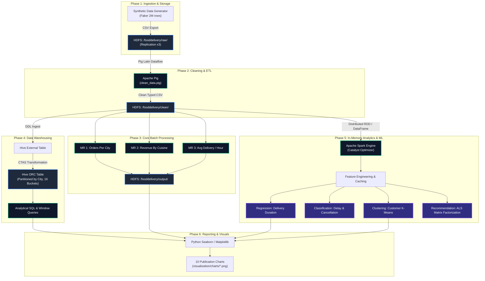

# 🏗️ System Architecture & Dataflow Documentation

## 1. High-Level Pipeline Architecture

The diagram below details how data transitions across the storage, compute, warehousing, machine learning, and visualization tiers:



---

## 2. Directory Layout in HDFS

```
hdfs://namenode:9000/fooddelivery/
├── raw/
│   └── food_delivery_data.csv        # Immutable raw data (~500 MB)
├── clean/
│   ├── part-m-00000.csv              # Pig-cleaned partition 1
│   └── part-m-00001.csv              # Pig-cleaned partition 2
├── output/
│   ├── orders_per_city/
│   │   └── part-r-00000              # MapReduce output (City/Area -> Count)
│   ├── revenue_per_cuisine/
│   │   └── part-r-00000              # MapReduce output (Cuisine -> Total, Count, Avg)
│   └── avg_delivery_per_hour/
│       └── part-r-00000              # MapReduce output (Hour -> Avg, Min, Max, Count)
└── models/
    ├── delivery_regressor_rf/        # Saved Spark MLlib Random Forest model
    ├── delay_classifier_rf/          # Saved Spark MLlib Classifier model
    └── customer_kmeans_k4/           # Saved K-Means clustering pipeline
```

---

## 3. Data Flow & Transformation Stages

| Stage | Input Schema | Operation | Output Schema |
|---|---|---|---|
| **Raw Ingest** | Unstructured CSV | Faker generation & HDFS copy | 23 raw fields |
| **Pig ETL** | Raw 23 fields | Filter corrupt rows, drop invalid distances, compute net revenue & speed | 28 enriched fields |
| **MapReduce** | Clean 28 fields | Key/Value partitioning, local combiner aggregation, global reducer summation | Aggregated tab-delimited text |
| **Hive Warehouse** | Clean 28 fields | Schema-on-read, Columnar compression (ORC), City partitioning, Customer bucketing | Optimized binary columnar store |
| **Spark Feature Eng.** | Clean 28 fields | VectorAssembler, StringIndexer, OneHotEncoder, StandardScaler | ML Feature Vectors |
| **MLlib** | Feature Vectors | Gradient descent, tree splitting, cross-validation | Predictions, Metrics, Cluster IDs |
| **Visualization** | Aggregation Outputs | Matplotlib & Seaborn rendering | PNG figures (150 DPI) |

---

## 4. Hive Table Architecture

```
                                  [ food_delivery_raw ]
                                  (External Text Table)
                                            │
                                            ▼
                    INSERT OVERWRITE TABLE food_delivery_orc_partitioned
                                PARTITION (city)
                                            │
               ┌────────────────────────────┼────────────────────────────┐
               ▼                            ▼                            ▼
         [ city=Mumbai ]              [ city=Delhi ]              [ city=Bangalore ]
         16 Buckets (ORC)             16 Buckets (ORC)             16 Buckets (ORC)
      ┌─────────┬─────────┐        ┌─────────┬─────────┐        ┌─────────┬─────────┐
      │bucket_00│bucket_01│...     │bucket_00│bucket_01│...     │bucket_00│bucket_01│...
      └─────────┴─────────┘        └─────────┴─────────┘        └─────────┴─────────┘
```

---

## 5. Spark MLlib Machine Learning Pipeline Architecture

```
   Raw DataFrame
        │
        ▼
[ StringIndexer ] ───> Converts 'weather', 'traffic_level', 'cuisine' to numeric indices
        │
        ▼
[ OneHotEncoder ] ───> Converts category indices to sparse one-hot binary vectors
        │
        ▼
[ VectorAssembler ] ─> Combines numeric features + encoded vectors into single 'features' vector
        │
        ▼
[ StandardScaler ] ──> Standardizes features to zero mean and unit variance (for K-Means)
        │
        ├──────────────────────┬──────────────────────┬──────────────────────┐
        ▼                      ▼                      ▼                      ▼
[ RF Regressor ]      [ RF Classifier ]       [ K-Means (K=4) ]       [ ALS Model ]
Predicts Delivery       Predicts Delay          Customer RFM           Collaborative
Duration (Minutes)       Probability             Segmentation         Filtering Recs
```
